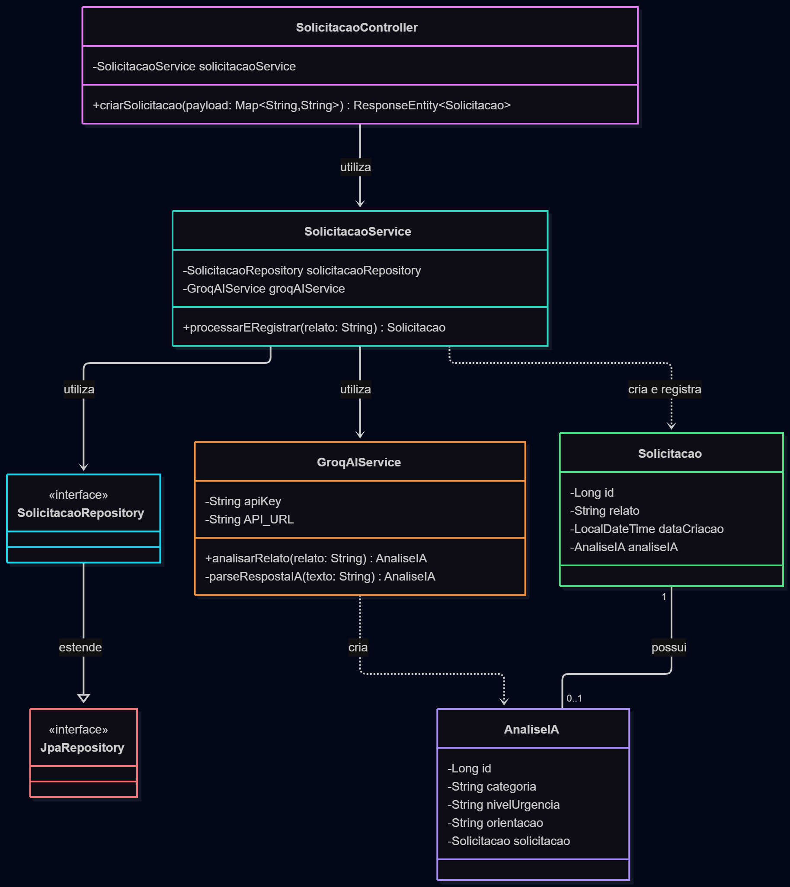
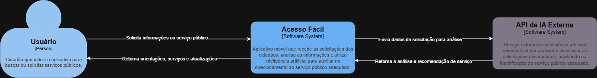
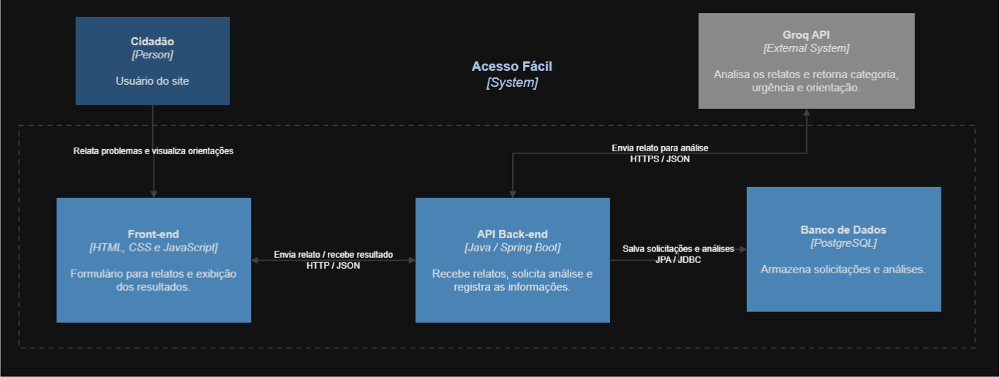

# 🏛️ Acesso Fácil — Direcionamento Inteligente aos Serviços Públicos

> **ODS 16:** Paz, Justiça e Instituições Eficazes  
> **Tecnologias:** Java (Spring Boot) | HTML, CSS e JavaScript | PostgreSQL | Groq API

---

## 🎯 ODS Escolhida
Nosso projeto ataca a **ODS 16 — Paz, Justiça e Instituições Eficazes**.
O objetivo é fortalecer a transparência e a eficácia das instituições, garantindo que qualquer cidadão consiga exercer seus direitos e acessar os serviços públicos municipais de forma rápida, simples e inclusiva.

---

## 🛑 O Problema Real
A maioria dos cidadãos não sabe a qual órgão recorrer quando enfrenta um problema na cidade (ex: iluminação com defeito, descarte irregular de lixo, buracos em vias ou emissão de documentos). A informação existe, mas está pulverizada em diversos portais e escrita com termos burocráticos. Isso gera frustração, perda de tempo e sobrecarga nos canais de atendimento por chamados encaminhados para os setores errados.

---

## ## 🤖 A Solução com Inteligência Artificial

O **Acesso Fácil** foi desenvolvido para ajudar cidadãos a entender melhor como lidar com problemas relacionados aos serviços públicos.

1. O usuário descreve seu problema em um formulário, utilizando suas próprias palavras.
2. O sistema envia o relato para uma API, que utiliza inteligência artificial para identificar a **categoria** e o **nível de urgência**.
3. Após a análise, o usuário recebe uma **orientação** sobre a situação relatada.
4. O relato e o resultado da análise são armazenados no banco de dados.

O projeto é um protótipo acadêmico e não realiza a abertura de solicitações diretamente nos órgãos públicos.

---

## 👥 Público Alvo 
* **Cidadãos em geral:** Pessoas de todas as idades que necessitam de atendimento público municipal mas encontram dificuldades com termos técnicos ou burocracia.
* **Comunidades e Líderes Comunitários:** Moradores que mapeiam demandas de bairros e buscam encaminhá-las para os órgãos competentes.

---

## 📐 Modelagem Inicial (Diagrama de Classes POO)

Abaixo está o modelo de domínio da aplicação, demonstrando as entidades em Java e seus relacionamentos:

### Explicação das Entidades (POO):
* **Solicitacao:** Armazena o relato enviado pelo cidadão, a data de criação e o resultado da análise.
* **AnaliseIA:** Armazena a categoria, o nível de urgência e a orientação gerada para o relato.

As entidades possuem um relacionamento de **um para um (1:1)**, pois cada solicitação está associada a uma análise.

---

## 🏗️ Arquitetura do Sistema (C4 Model)

Para detalhar a arquitetura técnica e o fluxo de dados do **Acesso Fácil**, utilizamos a notação do **C4 Model**.

### **Nível 1: Diagrama de Contexto**
Apresenta a visão geral do sistema, o cidadão utilizando a aplicação e a integração com a API externa de inteligência artificial.

### **Nível 2: Diagrama de Contêineres**
Apresenta as principais partes do sistema e como elas se comunicam: o front-end desenvolvido em **HTML, CSS e JavaScript**, o back-end em **Java com Spring Boot**, o banco de dados **PostgreSQL** e a **Groq API**.

---

## 📅 Gestão do Projeto

O acompanhamento das tarefas, a distribuição entre os integrantes e o fluxo de desenvolvimento são gerenciados publicamente através do nosso quadro Kanban:

📌 **[Acesse o Quadro de Gestão do Projeto (GitHub Projects)](https://github.com/users/Fremaan3110/projects/1)**
